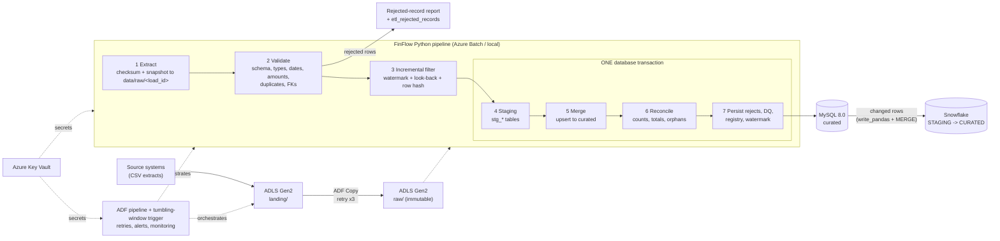

# Architecture

## Data flow

## Layers

| Layer | Where | Contents | Mutability |
|---|---|---|---|
| Source / landing | `data/source/...`, ADLS `landing/` | Files as delivered | Owned by source |
| **Raw** | `data/raw/<load_id>/`, ADLS `raw/<entity>/ingest_date=.../load_id=...` | Byte-identical copy + SHA-256 | Immutable (never overwritten) |
| **Staging** | `stg_*` tables (MySQL), `STAGING.STG_*` (Snowflake) | Validated, typed rows of one load, keyed by `load_id` | Rewritten per `load_id`; last N loads retained |
| **Curated** | `customers`, `accounts`, `transactions`, `payments` | Normalised, constrained, audited | Upsert only, never deleted by the pipeline |
| Control | `etl_*` tables | Audit, file registry, watermark, rejects, DQ, reconciliation | Append / upsert |

## Key design decisions

1. **Atomic load.** Staging, merge, reconciliation, rejects, DQ results, file registry and watermarks share one
   transaction. Any error, or any failed reconciliation check, rolls everything back. Only the `etl_load_audit` row
   (status `FAILED`) and best-effort diagnostics are written afterwards.
2. **Rerun safety, three layers.** (a) `etl_file_registry` has a unique `(entity, sha256)`, so the same file is
   skipped; (b) staging is keyed by `load_id` and rewritten; (c) the merge only writes rows whose `row_hash`
   differs, so even `--force` produces zero changes for identical data.
3. **Incremental loading.** Per-entity watermark = max `updated_at` loaded. Rows older than
   `watermark - look-back` are skipped **only if their key already exists in curated**; unseen keys are always
   loaded. (Found by test: a corrected, previously rejected record can carry an old `updated_at`.)
4. **Validation is read-only.** Nothing touches the database until all rules ran; rejected rows are never lost
   (report + table with rule codes and source row numbers).
5. **Cascading integrity.** Parents are validated first; children whose parent was rejected are rejected with
   `FK_VIOLATION` instead of failing the load.
6. **Circuit breaker.** If more than `FINFLOW_DQ_MAX_REJECT_PCT` (default 20 %) of a file is rejected, the load aborts.
7. **Money is `DECIMAL(18,2)`**; Python uses `Decimal`. Totals are reconciled per currency.
8. **MySQL is the target; SQLite is a dev/CI stand-in** with the same table and column names. MySQL-specific
   behaviour (`ON DUPLICATE KEY UPDATE`) is covered by `tests/test_mysql_integration.py`, which only runs when a MySQL is available.

## Reconciliation checks (all inside the transaction)

| Check | Meaning |
|---|---|
| `ROWS_SOURCE_TO_DISPOSITION` | file rows = rejected + skipped by watermark + staged |
| `ROWS_VALIDATED_TO_STAGING` | rows validated in Python = rows in `stg_*` |
| `ROWS_STAGED_TO_NEW_CHANGED_UNCHANGED` | staged = inserted + updated + unchanged |
| `ROWS_STAGING_TO_CURATED` | every staged row exists in curated with identical content hash |
| `AMOUNT_TOTAL_SOURCE_TO_STAGING:<CUR>` | per-currency amount total, Python vs staging SQL |
| `AMOUNT_TOTAL_STAGING_TO_CURATED:<CUR>` | per-currency amount total, staging vs curated |
| `NET_FLOW_SOURCE_TO_CURATED:<CUR>` | credits minus debits, source vs curated |
| `ORPHANS:<child>.<fk>` | curated orphan count must be 0 |

## Azure and Snowflake (UNTESTED)
See `azure/adf/README.md` and `sql/snowflake/`. ADF orchestrates landing -> raw copy, runs the Python
pipeline on Azure Batch (Custom activity), schedules via a tumbling-window trigger (retry policy, no overlap) and
raises alerts (Web activity -> webhook, Azure Monitor metric alert). None of this was deployed or executed.
